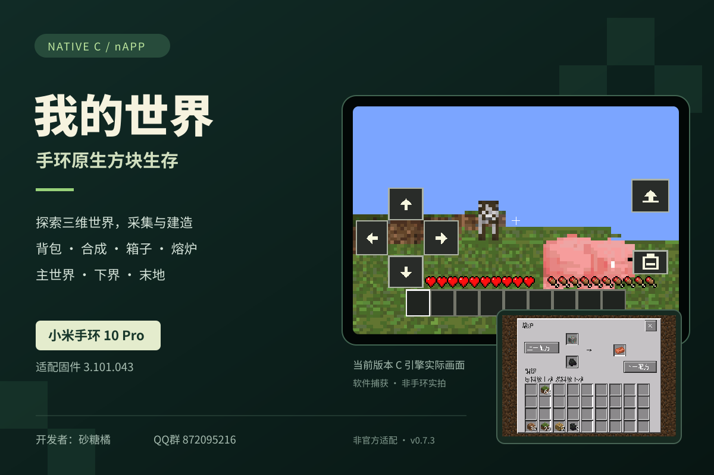

# 我的世界 · 手环原生方块生存游戏

开发者：砂糖橘 · QQ 群：872095216。非官方适配。

名称「我的世界」，资源 ID `minecraft-native`，标签 `游戏;3D;我的世界`。
版本 **0.7.3**。仅支持以下两组机型和固件，其他固件不支持：

| 机型 | 唯一支持固件 |
| --- | --- |
| 小米手环 9 Pro | **3.1.175** |
| 小米手环 10 Pro | **3.101.043** |

售价 **4 元**，沿用原爱发电商品及唯一 SKU，一次购买两款共用资格。
仓库下载目录仅存储 CreatorConsole 加密后的包体，不提供明文自装包或完整游戏源码。

## 发布状态

本仓库用于官方模块审核和付费上传准备，不等于已通过审核或已在官方源上架。
此前两次上传均完成仓库提交，但服务端加密登记未成功：第一次缺少 GitHub 绑定，第二次登录状态刷新失败。
用户现已完成账号绑定，正在重新登记两款加密文件。原失败清单保留在 audit/ 供核对。
只有服务端登记、付费配置及正式模块审核完成后，才能作为已上架付费资源交付。

## 私下模块审核

依[官方模块审核规则](https://github.com/AstralSightStudios/AstroBox-Repo#相关公告)，完整源码和编译流程须交给审核人员；最终上架模块由审核人员在安全审计后自行编译。
完整源码已准备：9 Pro 523 个文件、10 Pro 530 个文件，各含独立 rebuild.py、安装引导、固件配置、游戏和素材来源记录。
开发者选择**仅私下向审核人员提供完整源码**，不在公开仓库上传。
审核包不含系统固件、工具链或个人账号凭据；各工程仅重建本页标明的精确固件。
请审核当前独立原生引导的模块分发方式；分类为模块不代表已经完成 Canopus Supervisor 集成。

## 游戏与画面

保留三维探索、采集建造、背包合成、熔炉箱子、多世界存档，以及主世界、下界和末地。
流畅、均衡、清晰、精细档分别为 28×20、96×68、128×90、160×112。
优化遮挡液体、地面投影、控制按钮与快捷栏缓存、重复行格式转换。
9 Pro 明文安装对照包为 559,971 字节：原生资源无损分块压缩，保留玩法、材质和存档。
安装后恢复简洁数字时钟，安装包体大小不代表运行内存同比下降。

宣传截图来自当前 Native C 引擎实际的软件输出，不是实体手环照片，也不构成硬件帧率验收。

[付费发布流程](https://abox.run/docs/creator-tools/resource-management/paid-resources)
